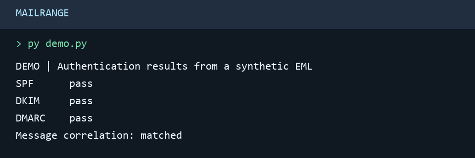

# MailRange

Envía un correo de prueba entre dos buzones que controlas y revisa cómo evaluó el receptor SPF, DKIM y DMARC.

Requiere Python 3.11 o posterior y un proveedor con SMTP autenticado sobre TLS implícito. Desde CMD:

    py mailrange.py send --smtp smtp.example.com --sender prueba@example.com --recipient destino@example.net --authorized
    py mailrange.py inspect recibido.eml --receiver mx.example.net --token ID_DEVUELTO

Sustituye los valores reservados por los de tu proveedor y tus buzones. Introduce la contraseña de aplicación cuando CMD la solicite. Exporta el mensaje original como EML desde el buzón receptor y usa el identificador de autenticación del servidor que confías. El primer comando confirma aceptación SMTP, mientras que el segundo necesita el mensaje efectivamente recibido.

El resultado recoge lo que declaró el servidor receptor. Usa el EML original y el encabezado que tu proveedor identifica como confiable. La coincidencia del token sirve para correlacionar el mensaje y no autentica el archivo ni sus encabezados. Pueden aparecer varios resultados DKIM cuando el correo tiene varias firmas.

Código 0 si DMARC pasó, 1 si falló y 2 si falta evidencia, es ambigua o hubo un error. El envío exitoso devuelve 0.

## Demo reproducible

Ejecuta `py demo.py` para comprobar el comportamiento con datos de prueba.

